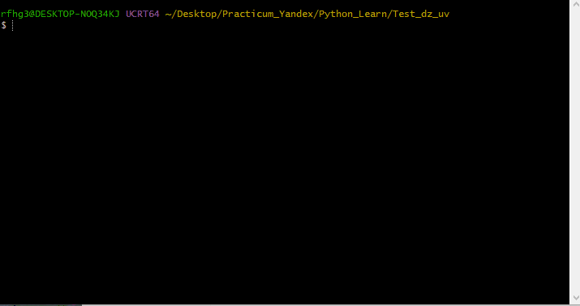
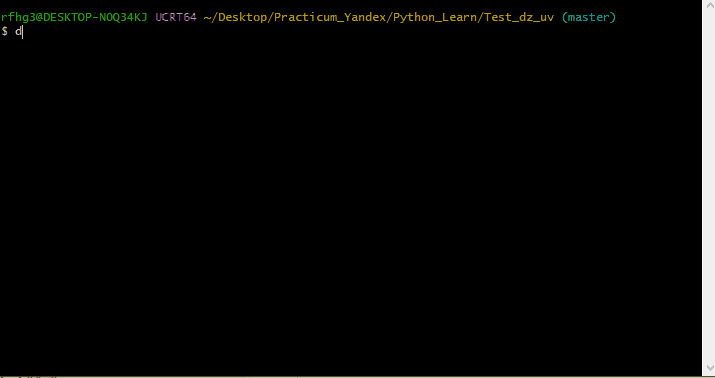
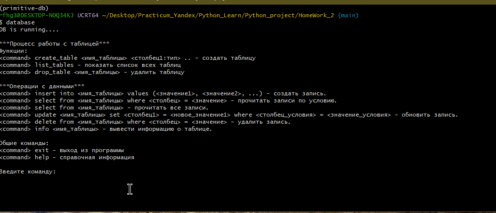

# project-2_Karpenko_26-555

# Запуск проекта

## Установка uv
>curl -LsSf https://astral.sh/uv/install.sh | sh
## проверка версии
>uv --version

## Инициализация 
>uv init

## Установка проекта
>uv tool install primitive-db-karpenko-26-555

## Запуск
>database

## При возникновении ошибок

После установки проекта через "uv":

>uv tool install primitive-db-karpenko-26-555

Для запуска приложения используйте полный путь к исполняемому файлу:

>$HOME/.local/bin/database (Linux)

Если используется пользователь "root":

>/root/.local/bin/database

После этого приложение запустится и выведет сообщение:

    DB is running....

## УПРАВЛЕНИЕ ТАБЛИЦАМИ

### Функции:
#### Cоздать таблицу
    create_table <имя_таблицы> <столбец1:тип> ..
#### Пример 
    Введите команду: create_table name ID:int column1:int column2:str column3:bool
    Таблица "name" успешно создана со столбцами: ID:int, column1:int, column2:str, column3:bool
#### Показать список всех таблиц
    list_tables
#### Пример 
    Введите команду: list_tables
    name
#### Удалить таблицу
    drop_table <имя_таблицы>
#### Пример 
    Введите команду: drop_table name
    Таблица "name" успешно удалена.

### Операции с данными
#### Cоздать запись в таблице
    insert into <имя_таблицы> values (<значение1>, <значение2>, ...)
#### Пример
    Введите команду: insert into name values (sergey, MEPHI, True)
    Запись с ID=1 успешно добавлена в таблицу "name".
#### Прочитать все записи или по условию.
    select from <имя_таблицы>
    select from <имя_таблицы> where <столбец> = <значение> 
#### Пример
    Введите команду: select from name
    +----+--------+-------+--------+
    | ID |  name  |  firm | access |
    +----+--------+-------+--------+
    | 1  | Sergey | MEPHI |  True  |
    | 2  | Pasha  |  SBER |  True  |
    +----+--------+-------+--------+
    Введите команду: select from name where ID = 1
    +----+--------+-------+--------+
    | ID |  name  |  firm | access |
    +----+--------+-------+--------+
    | 1  | sergey | MEPHI |  True  |
    +----+--------+-------+--------+
#### Обновить запись.
    update <имя_таблицы> set <столбец1> = <новое_значение1> where <столбец_условия> = <значение_условия> 
#### Пример
    Введите команду: update name set name = Sergey where name = Sarmat
    Запись с ID=3 в таблице 'name' обновлена.
#### Удалить запись.
    delete from <имя_таблицы> where <столбец> = <значение>
#### Пример
    Введите команду: delete from name where ID = 3
    Запись с ID=3 удалена из таблицы "name".
    ID таблицы "name" обновлены.
#### Вывести информацию о таблице.
    info <имя_таблицы> - 
#### Пример
    Введите команду: info name
    Таблица: name
    Столбцы: ID:int, name:str, firm:str, access:bool
    Количество записей: 2

### Общие команды:
    exit - выход из программы
    help - справочная информация

